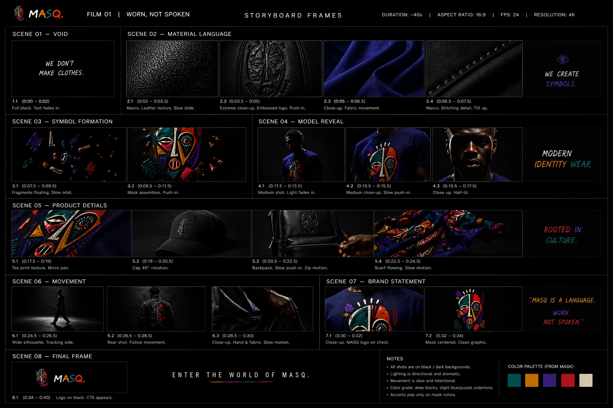
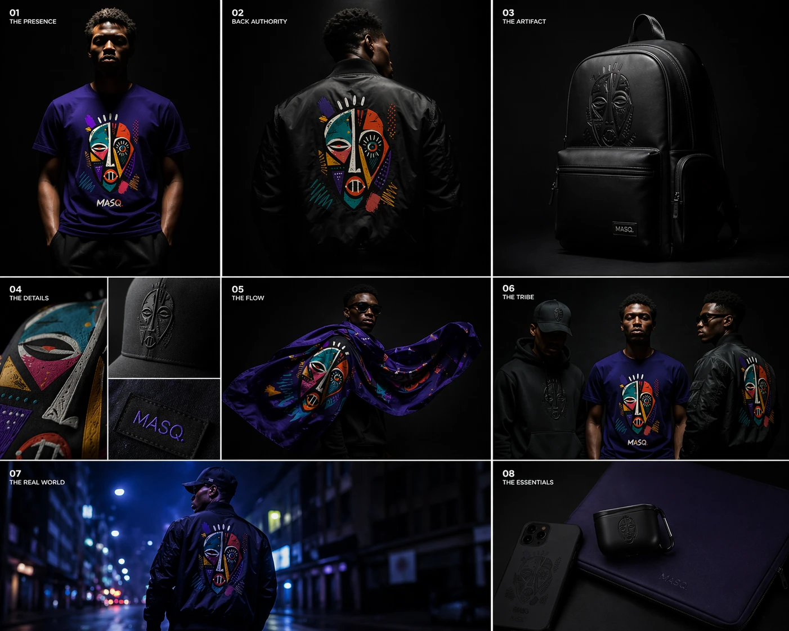
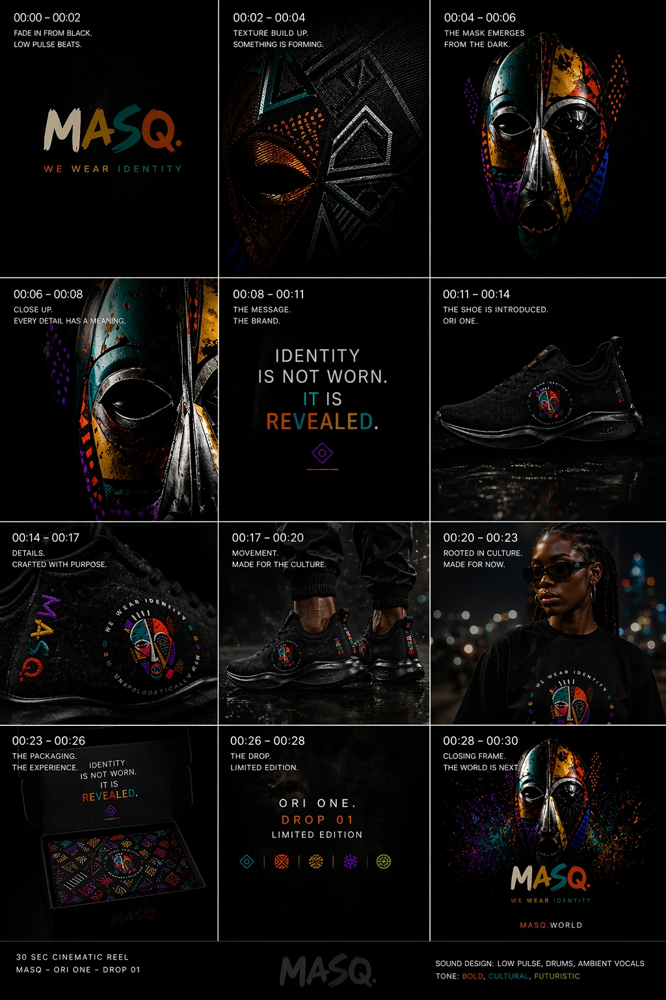
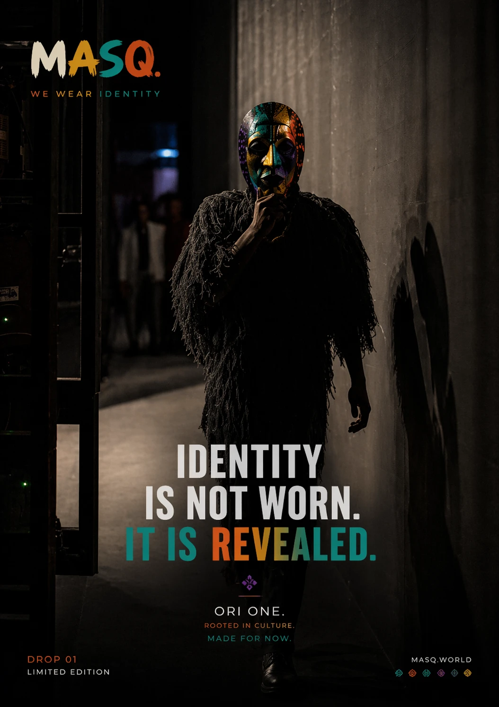
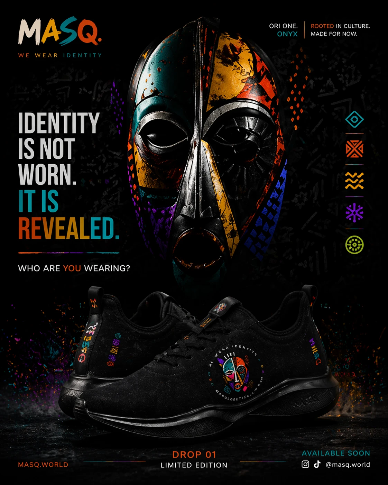

# MASQ. film boards

Five boards the owner shared for the brand film. The pictures are in this
folder; each is shown under its heading below (tap one to see it full size).

**Owner's next step:** go through these and choose what goes in, so we can
write a **Seedance 2.5** prompt for the video, to be made in **Google Flow**.
The shop already has a film slot on the home page (the film strip, and the
admin's film link), so the finished video can go straight there.

## 1. Film 01 — "Worn, Not Spoken" (storyboard frames)

About 40 seconds · 16:9 · 24 fps · 4K. Every shot on black or dark ground,
directional and dramatic light, slow and intentional movement, a grade with
deep blacks and a slight blue/purple undertone; colour only from the mask.
Palette from the mask: teal, amber, violet, red, cream.

| Scene | Time | Shot | Words on screen |
|---|---|---|---|
| 01 Void | 0:00–0:02 | Full black, text fades in | WE DON'T MAKE CLOTHES. |
| 02 Material language | 0:02–0:03.5 | Macro, leather texture, slow slide | |
| | 0:03.5–0:05 | Extreme close-up, embossed logo, push-in | |
| | 0:05–0:06.5 | Close-up, violet fabric moving | |
| | 0:06.5–0:07.5 | Macro, stitching, tilt up | WE CREATE SYMBOLS. |
| 03 Symbol formation | 0:07.5–0:09.5 | Coloured fragments floating, slow orbit | |
| | 0:09.5–0:11.5 | The mask assembles, push-in | |
| 04 Model reveal | 0:11.5–0:13.5 | Medium shot, light fades in (violet tee) | |
| | 0:13.5–0:15.5 | Medium close-up, slow push-in on the print | |
| | 0:15.5–0:17.5 | Close-up face, half-lit | MODERN IDENTITY WEAR |
| 05 Product details | 0:17.5–0:19 | Tee print texture, micro pan | |
| | 0:19–0:20.5 | Black cap turning 45° | |
| | 0:20.5–0:22.5 | Backpack, slow push-in, zip moving | |
| | 0:22.5–0:24.5 | Scarf flowing, slow motion | ROOTED IN CULTURE. |
| 06 Movement | 0:24.5–0:26.5 | Wide silhouette walking, tracking from the side | |
| | 0:26.5–0:28.5 | From behind, following (jacket with the mask) | |
| | 0:28.5–0:30 | Close-up, hand and fabric, slow motion | |
| 07 Brand statement | 0:30–0:32 | Close-up, MASQ. mask on the chest | |
| | 0:32–0:34 | The mask alone, centred, clean graphic | "MASQ IS A LANGUAGE. WORN. NOT SPOKEN." |
| 08 Final frame | 0:34–0:40 | Logo on black, call to action | ENTER THE WORLD OF MASQ. |

## 2. Campaign stills (eight frames)

01 The Presence: man in the violet mask tee, hands in pockets, dark ground ·
02 Back Authority: black bomber from behind, the mask on the back ·
03 The Artifact: black leather backpack with the embossed mask and MASQ. tab ·
04 The Details: embroidery close-up, embossed cap, the woven MASQ. label ·
05 The Flow: the violet mask scarf flying around a man in sunglasses ·
06 The Tribe: three men, black hoodie and cap, violet tee, black bomber ·
07 The Real World: bomber and cap at night on a blue-lit city street ·
08 The Essentials: phone case, earbuds case and a violet laptop sleeve, embossed.

## 3. "Ori One — Drop 01" (30-second reel, frame by frame)

Sound: low pulse, drums, ambient vocals. Tone: bold, cultural, futuristic.

| Time | What happens | Words |
|---|---|---|
| 00:00–00:02 | Fade in from black, low pulse beats | MASQ. WE WEAR IDENTITY |
| 00:02–00:04 | Texture builds, something forming | |
| 00:04–00:06 | The painted mask emerges from the dark | |
| 00:06–00:08 | Close-up: every detail has a meaning | |
| 00:08–00:11 | The message | IDENTITY IS NOT WORN. IT IS REVEALED. |
| 00:11–00:14 | The shoe is introduced: Ori One (black, mask badge) | |
| 00:14–00:17 | Details: crafted with purpose (the badge, "WE WEAR IDENTITY · UNAPOLOGETICALLY") | |
| 00:17–00:20 | Movement: feet in the shoes on wet ground | MADE FOR THE CULTURE. |
| 00:20–00:23 | A woman at night, city lights | ROOTED IN CULTURE. MADE FOR NOW. |
| 00:23–00:26 | The packaging, the experience (patterned box) | |
| 00:26–00:28 | The drop | ORI ONE. DROP 01 · LIMITED EDITION |
| 00:28–00:30 | Closing frame: mask in a burst of colour | MASQ. WE WEAR IDENTITY · MASQ.WORLD |

## 4. Poster — masked figure

A figure in a fringed black robe and the painted mask walking down a dim
corridor. "IDENTITY IS NOT WORN. IT IS REVEALED." · ORI ONE. · ROOTED IN
CULTURE. MADE FOR NOW. · DROP 01 LIMITED EDITION · MASQ.WORLD.

## 5. Poster — Ori One Onyx

The painted mask above the black Ori One shoe. "IDENTITY IS NOT WORN. IT IS
REVEALED." · WHO ARE YOU WEARING? · ORI ONE. ONYX · ROOTED IN CULTURE. MADE
FOR NOW. · DROP 01 LIMITED EDITION · AVAILABLE SOON · @masq.world.

## Questions to settle before the prompt

- One film or two? Film 01 (clothes, 40s) and Ori One (the shoe, 30s) are
  different stories.
- The address on the posters is **masq.world**; the shop's emails and pages
  will use whatever domain the shop goes live on. Decide which it is.
- Ori One is not in the shop yet. If the film announces it, the shop should
  have a page (or a "coming soon" with the waiting list) by the time it airs.
